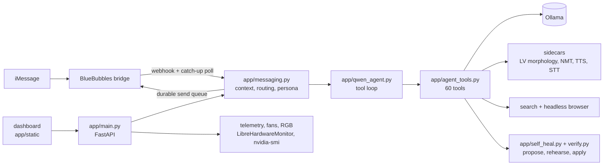

# Local AI

[](https://github.com/kristapskrauze/local-ai/actions/workflows/ci.yml)

A self-hosted assistant and machine dashboard that runs on one Windows
workstation with an RTX 3090. The language model (Ollama), speech recognition
and synthesis, translation, the agent's tools and the web UI all run on that
box. The only outside calls are the web searches and pages the agent reads,
and an optional cloud code review that runs only when explicitly asked for.

It has two faces:

- **Anton**, an assistant that takes part in iMessage conversations (through a
  BlueBubbles bridge) in Latvian and English, and has a private chat with its
  owner where it acts as a personal assistant with 60 tools.
- **The console**, a FastAPI dashboard (128 HTTP routes) for the machine itself:
  live GPU/CPU/disk telemetry, fan curves, RGB, Ollama models, sidecar health,
  and a Code tab that drives a local coding agent.

About 54k lines of Python in `app/`, 15k in `tests/`, and a dependency-free
JavaScript front end.

## What it does

**Conversations.** Anton answers as itself, a third participant, never as the
owner. Each chat keeps its own context and per-contact memory; replies can be
text, a voice note in its own voice (local TTS), or a picture. A routing step
asks the model what each message is about and which source can answer it
(public facts, a person, the machine, the calendar) instead of matching
keywords. A daily news digest is written from the morning's headlines and sent
at 09:00.

**An agent with tools.** A tool-calling loop around a local Qwen model with
web search and page reading in a real browser, calendar and reminders, route
planning (Valhalla + OpenStreetMap + street-level imagery), a Find My lookup,
the media library, classifieds search with watches, document, audio, image
and video inspection, and a calculator so arithmetic is never done in the
model's head. Replies that claim an action ("saved", "I changed the code") are
checked against the tools that actually ran.

**Reads, explains and repairs itself.** Anton can search its own source through
a read-only, sandboxed index (symbols, references, semantic search), explain
why it answered something from its traces and logs, and propose a fix. A fix is
applied only after the owner says yes, and only if it passes a verify ladder:

    AST -> ruff -> pyright -> the affected test suites -> keep or revert

Each file is judged against its own recorded baseline, so old findings never
block a change and a new one always does. A patch is rehearsed on a copy
before the owner is even asked, and anything that fails is put back.

**Builds small web apps on request.** "Make a snake game" produces a single
page, which is then opened in a headless browser, tapped, played and checked
(including Playwright tests the model writes for it) before Anton calls it
done. Pages can be published to a separate media box.

**Latvian.** A morphology parser (UDPipe) and a dictionary check verify word
forms the model writes, an NMT lane handles English-first reasoning, and a
Wikipedia BM25 index supplies Latvian facts.

## Design rules

- **The model decides; code enforces permissions.** No keyword list, regex or
  string match decides what a message means or where it goes. Deterministic
  code is used for parsing and for the safety and permission boundaries (who
  the owner is, who may write files, explicit approval before code is
  applied, SSRF blocks), and those fail closed. See [NO_HARD_GATES.md](NO_HARD_GATES.md).
- **Tool results, not guesses.** Times, dates, prices, distances and places
  come from tools. Silence is a valid answer; a confident invention is not.
- **One resident model.** Every lane uses the same Ollama tag, because two
  ~18 GB models cannot share a 24 GB card and a reload costs seconds per turn.

## Architecture



| Path | What is there |
| --- | --- |
| `app/` | the FastAPI service and every module it loads |
| `app/static/` | the dashboard: `/` (console), `/me` (personal assistant), `/mini`, `/pet` |
| `tests/` | 154 test files and `run_offline.py` |
| `_tools/` | Playwright page-test runner, the `repo-lookup` MCP server, Wikipedia index builder, iCloud login helper, Jellyfin screenshots |
| `_service/` | install and recovery scripts for the Windows service (NSSM) |
| `scripts/` | the WSL bridge that runs the coding agent in the user's session |
| `config.example/` | a complete config with placeholder people and handles |
| `tools/triage_scan.py` | pre-commit scan for secrets, personal data and filler comments |

## Running it

Needs Windows 10/11, Python 3.14 and [Ollama](https://ollama.com) with a chat
model (the default tag is `qwen3.8:latest`; change it in `config/messaging.json`).
Node 22 is needed for the page tests.

```powershell
git clone https://github.com/kristapskrauze/local-ai.git
cd local-ai
python -m pip install -r requirements.txt
Copy-Item -Recurse config.example config
python -m uvicorn app.main:app --host 127.0.0.1 --port 8765
```

Then open http://127.0.0.1:8765/ (console) or http://127.0.0.1:8765/me.

To run it as a service with fan control (which needs elevation), put
[`nssm.exe`](https://nssm.cc) in `_service/` and run
`_service\install_service.cmd` from an elevated shell. Hardware sensors and fan
control use [LibreHardwareMonitor](https://github.com/LibreHardwareMonitor/LibreHardwareMonitor);
its DLLs go in `_tools/LibreHardwareMonitor/`. Neither binary is in the repo.

### Configuration

`config/` is ignored by git. `config/messaging.json` holds the people the
assistant knows (with the Latvian case forms the prompts need), the contact
handles, the models and the feature switches. Everything outside the repo is
set with environment variables:

| Variable | Default | Used for |
| --- | --- | --- |
| `USER_HOME` | `~` | the profile that owns the AI folder (the service runs as LocalSystem) |
| `AI_HOME` | `USER_HOME\AI` | models, sidecar daemons, indexes |
| `COMFYUI_DIR` | `AI_HOME\ComfyUI` | image generation; its Python runs the GPU sidecars |
| `SERVICE_PYTHON` | the running interpreter | test runs started by the self-heal loop |
| `MEDIA_BOX_IP`, `MEDIA_BOX_IP_PARTNER`, `MEDIA_BOX_HOST`, `MEDIA_BOX_LAN_IP`, `MEDIA_BOX_HOME` | localhost | the separate media server (Jellyfin, published pages) |
| `BLUEBUBBLES_PASSWORD` | | the iMessage bridge |
| `WSL_HOME`, `WSL_CONFIG_HOME` | from `USER_HOME` | the coding agent inside WSL |

## Tests

```powershell
python tests/run_offline.py
```

Every test file runs in its own process with outbound connections refused and
the agent's ledgers redirected to a temp folder, and lands in PASS, FAIL,
NEEDS-NETWORK or TIMEOUT. Model calls are faked, so the suite runs in a few
minutes without a GPU. A few tests need data that is never committed (the
vocabulary built from the owner's own messages) and say SKIP without it.

CI runs on every push: the offline suite on Windows, ruff and a JavaScript
syntax check, and `tools/triage_scan.py`, which fails the build on any
credential file or hardcoded secret.

## License

MIT. See [LICENSE](LICENSE).
